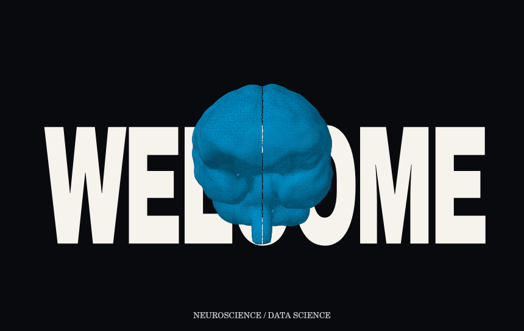
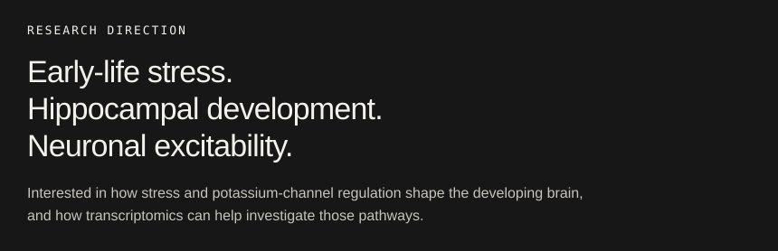

<table width="100%">
  <tr>
    <td width="40%" valign="top">
      <h3>Languages</h3>
      
&nbsp; Python &emsp; &nbsp; R

      
&nbsp; C++ &emsp; &nbsp; HTML

       
      
<a href="https://cesar-researchportfolio.com/">Research portfolio ↗</a>

      
<a href="https://www.linkedin.com/in/cesar-sierra-tamhead">LinkedIn ↗</a>

    </td>
    <td width="60%" valign="top">
      
      <h2>Understanding brains. Building models.</h2>
      
I study neuroscience and data science at the University of Michigan, work with the TaD Lab on the SAND study, and develop EEG projects exploring how computation can help us understand neural signals.

      
        
      
      
<a href="https://cesar-researchportfolio.com/">Explore my research portfolio ↗</a>

    </td>
  </tr>
</table>
